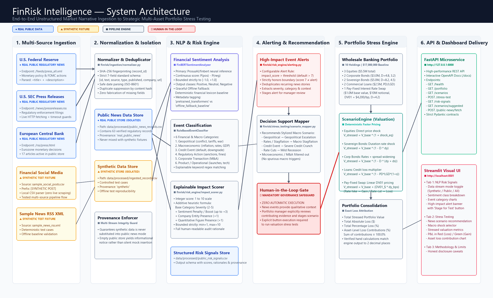

# FinRisk Intelligence

**AI-Powered Financial Risk Engine & Strategic Portfolio Stress Testing**  
*Developed for the S&P Global & CRISIL Campus Hackathon*

[](https://www.python.org/downloads/)
[](https://fastapi.tiangolo.com/)
[](https://streamlit.io/)
[](tests/)
[](LICENSE)

> **Submission Metadata Placeholders**  
> • **Candidate Name:** `[Ramisetty Aparanjith]`  
> • **Official Email:** `[23je0787@iitism.ac.in]`  
> • **Institution / College:** `[IIT ISM Dhanbad]`  
> • **Public GitHub Repository:** `[https://github.com/Aparanjith25/FinRisk-Intelligence]`  
> • **Unlisted Demonstration Video:** `[https://youtu.be/hfqHQLqod7w]`  
> • **Presentation Slide Deck:** [`docs/presentation.pdf`](docs/presentation.pdf)  
> • **Architecture Diagram:** [`docs/architecture.png`](docs/architecture.png)  

---

## 📌 Executive Summary

**FinRisk Intelligence** is an enterprise-grade financial risk platform that connects real-time unstructured market narratives with quantitative multi-asset portfolio stress testing. The platform ingests both controlled synthetic benchmark data and official regulatory financial news feeds (U.S. Federal Reserve, U.S. SEC, European Central Bank), applies explainable NLP risk scoring, and evaluates deterministic valuation shocks across equities, sovereign debt, corporate credit, and commercial loans.

### Core Capabilities
1. **Multi-Stream Data Ingestion & Deduplication:** Parses RSS/Atom XML news and social media CSVs into a standardized schema with deterministic SHA-256 fingerprinting and strict provenance isolation.
2. **AI/NLP Risk Engine:** Financial sentiment analysis mapped to continuous scores in `[-1.0, 1.0]`, rule-based financial event classification across 6 categories, and explainable integer impact scoring (`1` to `10`) with full audit rationales.
3. **Strategic Portfolio Stress Testing:** Multi-asset valuation sensitivity approximations across Equities, Government Bonds, Corporate Bonds, and Loans under preconfigured macroeconomic, geopolitical, and credit shock scenarios.
4. **REST API & Interactive Dashboard:** Production-ready FastAPI microservice with OpenAPI documentation and an interactive Streamlit analytics dashboard supporting dual-stream data exploration and local fallback execution.
5. **Honest AI & Comprehensive Verification:** 147 collected tests passing with 100% pass rate: 143 offline tests passing without external network dependencies, and all 147 tests passing when optional deep-learning dependencies (`torch`, `transformers`) are enabled for live ProsusAI/FinBERT inference. Transparent metadata labeling (`offline_fallback_baseline`, `offline_injected_mock`, vs. `pretrained_transformers`) provides explicit non-fabrication guarantees.

---

## 🏗️ Architecture & Directory Layout



```text
FinRisk-Intelligence/
├── configs/
│   ├── public_feeds.yaml           # Verified public RSS feeds (Federal Reserve, SEC, ECB)
│   └── stress_scenarios.yaml       # Macroeconomic, geopolitical, and credit shock parameters
├── data/
│   ├── processed/                  # Normalized records and structured risk signals
│   │   ├── ingested_records.csv    # Synthetic ingested records
│   │   ├── public_news_records.csv # Real public regulatory news records
│   │   ├── public_risk_signals.csv # Real public risk signals
│   │   └── risk_signals.csv        # Synthetic risk signals
│   └── sample/                     # Synthetic seed test fixtures (tracked in Git)
│       ├── sample_news_rss.xml
│       ├── sample_portfolio.csv
│       └── sample_social_posts.csv
├── docs/                           # Submission & demonstration materials
│   ├── architecture.png            # High-resolution 2K system architecture diagram
│   ├── presentation.pdf            # 7-slide final hackathon presentation deck
│   ├── demo_walkthrough.md         # 5-minute live pitch & 15-minute recorded demo scripts
│   ├── github_readiness_checklist.md # Final GitHub readiness & secrets audit checklist
│   ├── presentation_outline.md     # 5–7 slide presentation outline for jury review
│   └── final_acceptance_audit.md   # Complete end-to-end audit report (PASS WITH LIMITATIONS)
├── finrisk/                        # Core Python application package
│   ├── api/                        # FastAPI service layer
│   │   └── main.py
│   ├── dashboard/                  # Streamlit visual dashboard
│   │   └── app.py
│   ├── ingestion/                  # Data normalizer, RSS parser, CSV loader, public news
│   │   ├── news_ingestion.py
│   │   ├── normalizer.py
│   │   ├── public_news.py
│   │   └── social_ingestion.py
│   ├── nlp/                        # Financial sentiment analysis & event classification
│   │   ├── event_classifier.py
│   │   └── sentiment_analyzer.py
│   ├── risk_engine/                # Impact scoring & signal consolidation
│   │   ├── engine.py
│   │   └── impact_scorer.py
│   └── stress_testing/             # Portfolio valuation & macro scenario engine
│       ├── portfolio.py
│       └── scenario_engine.py
├── scripts/
│   ├── fetch_public_news.py        # Public news ingestion & risk scoring runner
│   ├── run_ingestion.py            # Synthetic pipeline ingestion runner
│   └── run_risk_engine.py          # Synthetic risk engine runner
├── tests/
│   ├── conftest.py
│   ├── fixtures/                   # Offline XML test fixtures (Fed, SEC)
│   ├── integration/                # End-to-end integration test suites
│   └── unit/                       # Component-level unit test suites
├── pyproject.toml
├── pytest.ini
├── README.md
└── requirements.txt
```

---

## 🚀 Quickstart & Setup Instructions

### 1. Environment Setup
```powershell
# 1. Clone repository (or navigate to workspace)
cd FinRisk-Intelligence

# 2. Create Python virtual environment (Python >=3.11, e.g. 3.11 or 3.13)
python -m venv .venv

# 3. Activate virtual environment
.\.venv\Scripts\Activate.ps1

# 4. Install core dependencies (lightweight offline mode)
pip install -r requirements.txt
pip install -e .

# Optional: Install deep learning stack for live ProsusAI/FinBERT inference
# (Requires system with >4 GB RAM and >2 GB free disk)
pip install -r requirements-finbert.txt
```

### 2. Run Test Suite
The test suite adapts automatically to installed dependencies:
```powershell
.\.venv\Scripts\python.exe -m pytest -v
```
* **Full Environment (with `torch` & `transformers`):** `147 passed in ~41s` (All 147 unit, integration, evaluation, alert, derivative valuation, and live FinBERT inference tests pass).
* **Lightweight Offline Environment:** `143 passed, 4 skipped in ~25s` (The 4 live FinBERT neural inference tests are cleanly skipped when PyTorch/Transformers are omitted).

> **Note on Fresh Clones & Data Reproduction:**  
> Processed public regulatory records are intentionally excluded from git tracking to prevent stale data bloat. After cloning a fresh repository, run `python scripts/fetch_public_news.py` to ingest and score the latest live public articles from the Federal Reserve, SEC, and ECB. Synthetic demo records (`data/sample/`) are fully version-controlled and immediately functional.

### 3. Run Pipeline Batch Scripts
```powershell
# 1. Run Synthetic Ingestion Pipeline (Milestone 1)
.\.venv\Scripts\python.exe scripts/run_ingestion.py

# 2. Run Synthetic AI/NLP Risk Engine (Milestone 2)
.\.venv\Scripts\python.exe scripts/run_risk_engine.py

# 3. Ingest Real Public Regulatory News Feeds (Milestone 4)
.\.venv\Scripts\python.exe scripts/fetch_public_news.py
```

### 4. Start FastAPI REST Service
```powershell
.\.venv\Scripts\uvicorn.exe finrisk.api.main:app --host 127.0.0.1 --port 8000 --reload
```
Interactive OpenAPI documentation will be accessible at: **`http://127.0.0.1:8000/docs`**

### 5. Launch Streamlit Visual Analytics Dashboard
```powershell
.\.venv\Scripts\streamlit.exe run finrisk/dashboard/app.py
```
Interactive dashboard will open in your browser at: **`http://localhost:8501`**

---

## 📡 API Endpoints & Sample Responses

### 1. Health Check
* **Endpoint:** `GET /health`
* **Response:**
  ```json
  {
    "status": "ok",
    "version": "0.1.0",
    "service": "FinRisk Intelligence API"
  }
  ```

### 2. Baseline Portfolio Holdings
* **Endpoint:** `GET /portfolio`
* **Response:**
  ```json
  {
    "asset_count": 10,
    "total_market_value": 17000000.0,
    "asset_type_distribution": {
      "equity": 5500000.0,
      "corporate_bond": 3000000.0,
      "government_bond": 5000000.0,
      "loan": 2500000.0,
      "derivative": 1000000.0
    }
  }
  ```

### 3. List Preconfigured Stress Scenarios
* **Endpoint:** `GET /scenarios`
* **Response:**
  ```json
  {
    "total_scenarios": 4,
    "scenarios": {
      "geopolitical_escalation": {
        "name": "Geopolitical Escalation & Trade Shock",
        "category": "Geopolitical",
        "parameters": {
          "equity_shock_pct": -18.0,
          "interest_rate_shock_bps": 50.0,
          "credit_spread_shock_bps": 120.0,
          "loan_loss_shock_pct": 25.0
        }
      }
    }
  }
  ```

### 4. Execute Scenario Stress Test
* **Endpoint:** `POST /stress-test`
* **Request Body:**
  ```json
  {
    "scenario_id": "macroeconomic_stagflation"
  }
  ```
* **Response:**
  ```json
  {
    "scenario_id": "macroeconomic_stagflation",
    "scenario_name": "Macroeconomic Stagflation & Rate Spike",
    "category": "Macroeconomic",
    "baseline_portfolio_value": 17000000.0,
    "stressed_portfolio_value": 15960740.0,
    "total_absolute_loss": 1039260.0,
    "total_percentage_loss": 6.11,
    "asset_results": [
      {
        "asset_id": "EQ_001",
        "asset_name": "AlphaCorp Common Stock",
        "asset_type": "equity",
        "baseline_value": 2500000.0,
        "stressed_value": 2125000.0,
        "absolute_loss": 375000.0,
        "percentage_loss": 15.0,
        "loss_contribution_pct": 36.08,
        "valuation_method": "Equity Price Shock: V_stressed = V_base * (1 + shock_pct)"
      },
      {
        "asset_id": "SW_001",
        "asset_name": "5Y Interest Rate Swap (Pay-Fixed Macro Hedge)",
        "asset_type": "derivative",
        "baseline_value": 1000000.0,
        "stressed_value": 1630000.0,
        "absolute_loss": -630000.0,
        "percentage_loss": -63.0,
        "loss_contribution_pct": -60.62,
        "valuation_method": "Linear DV01 Swap Pricing: V_stressed = V_base + (DV01_$ * dy_rates_bps)"
      }
    ],
    "disclaimer": "Simulated stress test results are deterministic valuation approximations..."
  }
  ```

### 5. Filtered Risk Signals (by Provenance)
* **Endpoint:** `GET /risk-signals?provenance=real_public_news&limit=10`
* **Response:**
  ```json
  {
    "total_count": 10,
    "provenance": "real_public_news",
    "signals": [
      {
        "record_id": "ace881c871481cb4",
        "source": "U.S. Federal Reserve Press Releases",
        "published_at": "2026-10-09T14:00:00+00:00",
        "event_type": "Macroeconomic",
        "sentiment_label": "neutral",
        "sentiment_score": "0.0",
        "impact_score": "4",
        "url": "https://www.federalreserve.gov/newsevents/pressreleases/other20261009a.htm",
        "provenance": "real_public_news",
        "inference_source": "offline_fallback_baseline"
      }
    ]
  }
  ```

---

## 🧮 Valuation Stress Testing Methodology

Portfolio shocks are computed across four distinct asset classes using mathematically consistent formulas:

| Asset Class | Valuation Stress Formula | Key Sensitivity Parameters |
| :--- | :--- | :--- |
| **Equities** | $V_{\text{stressed}} = V_{\text{base}} \times (1 + \Delta_{\text{equity}})$ | Direct percentage equity return shock |
| **Government Bonds** | $V_{\text{stressed}} = V_{\text{base}} \times (1 - D_{\text{mod}} \times \Delta y_{\text{rates}})$ | Modified duration ($D_{\text{mod}}$), Sovereign yield shock ($\Delta y_{\text{rates}}$) |
| **Corporate Bonds** | $V_{\text{stressed}} = V_{\text{base}} \times (1 - D_{\text{mod}} \times (\Delta y_{\text{rates}} + \Delta s_{\text{spread}}))$ | Modified duration ($D_{\text{mod}}$), Rates shift ($\Delta y$), Credit spread widening ($\Delta s$) |
| **Loans** | $V_{\text{stressed}} = V_{\text{base}} \times (1 - (\text{PD} \times \text{LGD} \times (1 + \Delta_{\text{loan\_loss}})))$ | Baseline default probability ($\text{PD}$), Loss given default ($\text{LGD}$), Loss multiplier |
| **Interest Rate Swap (Pay-Fixed)** | $V_{\text{stressed}} = V_{\text{base}} + (\text{DV01}_{\$} \times \Delta y_{\text{rates, bps}})$ | Dollar DV01 ($\text{DV01}_{\$}$), Basis point rate shift ($\Delta y_{\text{rates, bps}}$) |

### Portfolio Loss Consistency
- **Absolute Portfolio Loss:** $\Delta V = \sum_{i} V_{\text{base}, i} - \sum_{i} V_{\text{stressed}, i}$
- **Percentage Portfolio Loss:** $\Delta V_{\%} = \frac{\Delta V}{\sum_{i} V_{\text{base}, i}} \times 100\%$
- **Asset Loss Contribution:** $\text{Contribution}_i = \frac{\Delta V_i}{\Delta V} \times 100\%$
- **Verification Guarantee:** $\sum_{i} \text{Contribution}_i \equiv 100.0\%$, verified across all scenarios.

### Preconfigured Macro Stress Scenarios ($17.0M Wholesale Portfolio)
- **Geopolitical Escalation & Trade Shock:** Equity -18%, Rates +50 bps, Spreads +120 bps, Loan loss +25% $\rightarrow$ **-7.12% portfolio loss ($1,210,568.75)**.
- **Macroeconomic Stagflation & Rate Spike:** Equity -15%, Rates +150 bps, Spreads +100 bps, Loan loss +20% $\rightarrow$ **-6.11% portfolio loss ($1,039,260.00)**.
- **Severe Credit Crunch & Spread Widening:** Equity -12%, Rates -50 bps, Spreads +300 bps, Loan loss +60% $\rightarrow$ **-9.67% portfolio loss ($1,643,393.75)**.
- **Mild Recessionary Cooling:** Equity -5%, Rates -50 bps, Spreads +30 bps, Loan loss +10% $\rightarrow$ **-2.31% portfolio loss ($392,406.25)**.

---

## 📰 Data Provenance & Real Public News Feeds

FinRisk Intelligence supports two distinct, isolated data streams:
1. **Synthetic Data Baseline:** Hand-crafted, standardized RSS and social media records designed for deterministic integration and unit testing.
2. **Real Public Regulatory News:** Official RSS syndication feeds from official regulatory authorities:
   - **U.S. Federal Reserve Press Releases:** `https://www.federalreserve.gov/feeds/press_all.xml`
   - **U.S. SEC Press Releases:** `https://www.sec.gov/news/pressreleases.rss`
   - **European Central Bank Press Releases:** `https://www.ecb.europa.eu/rss/press.html`

### Provenance Safeguards
- **Separate File Stores:** Real articles reside in `data/processed/public_news_records.csv` and `data/processed/public_risk_signals.csv`; synthetic data resides in `ingested_records.csv` and `risk_signals.csv`.
- **Zero Hallucination:** Companies and dates are never fabricated; if absent from public announcements, `company` remains `None`.
- **Empty State Notice:** In *Real Public Financial News* mode, if no public articles exist, the dashboard displays an explicit empty-state notice. Synthetic records are never substituted into the real-news stream.
- **Canonical Attribution:** Every public risk signal contains its source URL, publication timestamp, and provenance metadata badge.

---

## ⚠️ Modeling Assumptions & Limitations (Honest AI Principles)

1. **Stylized Sensitivity vs. Calibrated Forecasting:** Portfolio stress testing calculates deterministic holding sensitivities under stylized shocks. It does **not** predict actual market losses, macroeconomic default probabilities, or statistical Value at Risk (VaR).
2. **Qualitative Intelligence vs. Quantitative Calibration:** Financial NLP risk signals highlight emerging operational, credit, or geopolitical events. They do **not** automatically calibrate quantitative basis-point rate shocks.
3. **Provisional NLP Heuristics:** Financial event classifications are driven by deterministic regex rules designed for pipeline validation. Sentiment inference in offline mode utilizes a transparent domain baseline (`offline_fallback_baseline`), explicitly labeled to prevent false claims of active deep learning execution.
4. **Zero Web Scraping / Compliance:** The platform strictly accesses public-domain RSS syndication feeds using respectful bounded timeouts (10s) and standard User-Agent identification. No access controls or paywalls are bypassed.
5. **Preliminary Sentiment Benchmark:** An isolated preliminary benchmark across 30 human-annotated regulatory articles yielded 76.67% accuracy (Macro F1: 0.7548) for genuine FinBERT vs. 70.00% accuracy (Macro F1: 0.6849) for the deterministic baseline. On the 8-article held-out ECB subset, the deterministic baseline achieved 87.5% accuracy vs. FinBERT's 75.0%, as FinBERT conservatively classified all eight articles as neutral due to hedged central-bank phrasing. Because the overall evaluation sample size is preliminary ($N = 30$), these metrics demonstrate architectural feasibility rather than generalized real-world superiority.
6. **Linear Duration Approximation:** Fixed-income sensitivity employs first-order modified duration without second-order convexity adjustments; large yield shocks (>200 bps) represent stylized linear approximations rather than full DCF cash-flow repricing.

---

## 📁 Submission Materials & Presentation Resources
 
- **Presentation Slide Deck (7 Slides):** [`docs/presentation.pdf`](docs/presentation.pdf) — Complete 7-slide pitch deck tailored for hackathon jury evaluation.
- **System Architecture Diagram (2K High-Res):** [`docs/architecture.png`](docs/architecture.png) — End-to-end pipeline architecture diagram distinguishing real public data from synthetic fixtures.
- **Presentation Slide Outline:** [`docs/presentation_outline.md`](docs/presentation_outline.md) — 5–7 slide pitch narrative script.
- **Demonstration Walkthrough Scripts:** [`docs/demo_walkthrough.md`](docs/demo_walkthrough.md) — 5-minute live demonstration script and 15-minute recorded technical walkthrough.
- **End-to-End Acceptance Audit Report:** [`docs/final_acceptance_audit.md`](docs/final_acceptance_audit.md) — Complete audit report with verified test traces, math proofs, and transparent disclosures.
- **GitHub Readiness Checklist:** [`docs/github_readiness_checklist.md`](docs/github_readiness_checklist.md) — Pre-submission verification covering data files, dependencies, `.gitignore`, and zero-secrets audit.

---

## 📄 License

This project is licensed under the MIT License — see the [LICENSE](LICENSE) file for details.
